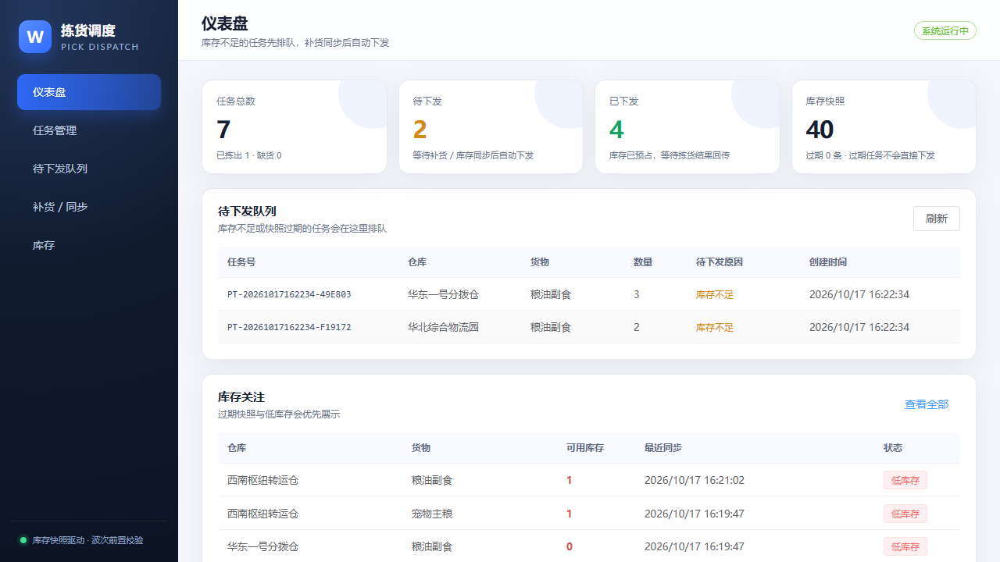
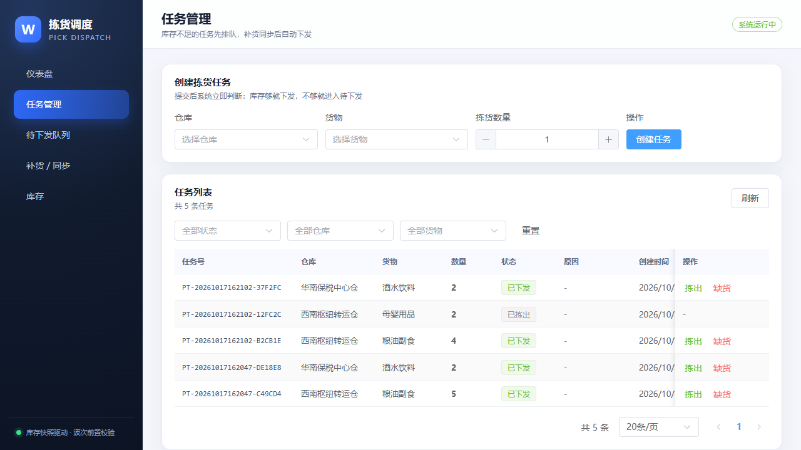

# 拣货任务下发系统

基于**库存快照**的拣货任务前置校验系统：库存够就立即下发；库存不够、无库存或快照过期就进入待下发队列；补货/库存同步后按先进先出自动重扫下发；每次下发调用通知接口（当前为日志桩，接口可替换）。

技术栈：**Spring Boot 3.2 + Java 17 + MySQL 8 + Vue 3 + Vite + Element Plus**。



## 我的判断

### 看到了什么

对 `data/picks.csv` 的分析（可由 `node analysis/analyze.mjs` 复现）：

- 原始 1,195 行；`pick_id` 有 57 组完全重复记录，去重后 **1,138 个任务**；46 条 `fulfilled` 未回传。
- 有回传的 1,092 条中，**141 次到位缺货，缺货率 12.91%**。
- 缺货的最强信号是**库存快照年龄**，不是账面库存：

| 快照年龄 | 任务数 | 缺货数 | 缺货率 |
|---|---:|---:|---:|
| <10 分钟 | 782 | 23 | **3.1%** |
| 10–15 分钟 | 16 | 7 | 43.8% |
| 15–30 分钟 | 137 | 46 | 34.3% |
| ≥30 分钟 | 203 | 65 | 33.3% |

- 分仓差异说明不能“一刀切”：

| 仓库 | 新鲜任务（<10 min） | 新鲜缺货率 | 过期任务（≥10 min） | 过期缺货率 |
|---|---:|---:|---:|---:|
| 西南枢纽转运仓 | 224 | 1.8% | 96 | 35.8% |
| 华北综合物流园 | 172 | 1.8% | 98 | 42.1% |
| 华南保税中心仓 | 190 | 2.2% | 73 | 55.6% |
| 华东一号分拨仓 | 196 | 6.5% | 89 | **4.8%** |

- 账面库存不是可靠信号：`stock_qty = 0` 的 40 条任务中，有回传的 38 条里仍有 **28 条成功拣出**，缺货率仅 26.3%。

### 根问题

波次下发依赖的库存快照已经过期，账面库存与实物不一致，拣货员按错误库存出行，到了货位才发现缺货。快照年龄超过 10 分钟后，缺货率从约 3% 跳到 30%–55%。

华东一号是必须排除的反例：它的过期快照缺货率只有 4.8%，与新鲜时 6.5% 基本无差异。合理假设是它的 `stock_synced_at` 存在日志/时间戳滞后，或同步链路与其他仓不同；**不能把它的“时间戳旧”直接当成“库存数据旧”**。

### 成本口径与盈亏平衡

需求给出：每次到位缺货损失 **75 分钟**，每次提前阻断/复核花费 **15 分钟**。

提前阻断只有在 `P(缺货) × 75 > 15`，即 **P(缺货) > 20%** 时才划算。这决定了规则必须“有选择地拦”，不能全部拦。

## 做了什么

### 业务流程

```
创建拣货任务
   │
   ├─ 查询该仓库 + 货物的库存快照
   │
   ├─ 库存足够且快照未过期 ──→ 创建 DISPATCHED 任务，预占库存，调用通知接口
   │
   └─ 否则 ──→ 创建 PENDING 任务（原因：库存不足 / 快照过期 / 无库存）
                   │
                   └─ 补货 / 库存同步
                         │
                         └─ 按创建时间 FIFO 扫描待下发任务
                               ├─ 够 → DISPATCHED，扣减库存，调用通知接口
                               └─ 不够 → 继续等待
```

### 后端

- **数据表**：`warehouse`、`goods`、`inventory`、`inventory_snapshot`、`pick_task`、`replenishment`、`replenishment_item`、`notification_log`。
- **创建任务**：
  - 对 `inventory` 行加悲观锁，防止并发超卖；
  - 库存足够且快照年龄 <10 分钟 → `DISPATCHED` 并扣减库存；
  - 库存不足 → `PENDING / INSUFFICIENT_STOCK`；
  - 快照过期 → `PENDING / SNAPSHOT_STALE`；
  - 无库存记录 → `PENDING / NO_INVENTORY`；
  - `request_no` 幂等，重复请求返回同一任务。
- **补货/同步**：
  - 支持一张补货单多条货物明细；
  - 按 `goods_id` 排序加锁，避免死锁；
  - 更新库存和 `synced_at`，写入库存快照历史；
  - 对每条货物扫描同仓库 + 同货物的待下发任务，严格 FIFO；
  - 补货单号幂等。
- **通知**：
  - `TaskNotificationService` 接口，默认实现写日志并落 `notification_log`；
  - 事务提交后触发（`@TransactionalEventListener(AFTER_COMMIT)`）；
  - 通知使用 `REQUIRES_NEW` 独立事务，失败只记录日志，不影响任务下发。
- **结果回传**：`DISPATCHED` 任务可回传 `FULFILLED` / `STOCKOUT`，形成闭环。

### 前端

Vue 3 + Element Plus，五个页面：

- **仪表盘**：任务总数、待下发、已下发、库存快照过期数、待下发队列、库存关注。
- **任务管理**：创建任务、按状态/仓库/货物筛选、回传拣出/缺货。
- **待下发队列**：等待时长、原因、创建时快照年龄。
- **补货 / 同步**：多明细补货，提交后展示自动下发的任务。
- **库存**：可用库存、同步时间、快照年龄、过期/低库存标识。



### 关键设计取舍

1. **快照新鲜度可配置**：`dispatch.max-snapshot-age-minutes` 默认 10；设为 `<=0` 可关闭，严格按数量判断。
2. **严格 FIFO**：补货后先满足更早的待下发任务；如果当前任务库存不够就停止，不跳过它去下发更小的任务，保证公平。
3. **预占库存**：任务下发时扣减 `available_qty`；如果后续回传缺货，只记录结果，不自动回补，留待对账。
4. **通知与业务解耦**：接口先留桩，未来可替换短信/企业微信/站内信，不影响下发事务。
5. **不做登录权限**：演示聚焦核心流程；生产化时再加认证和操作审计。

## 怎么证明有用

### 数据侧：按仓规则的成本账

推荐规则：

```
snapshot_age_min >= 10  且  warehouse != '华东一号分拨仓'
```

| 指标 | 数值 |
|---|---:|
| 阻断任务数 | 267 |
| 其中真实缺货 | 114 |
| 命中率 | 42.7% |
| 避免缺货工时 | 8,550 分钟 |
| 复核成本 | 4,005 分钟 |
| 净收益 | **4,545 分钟（75.8 小时）** |
| 覆盖已确认缺货 | 80.9% |
| 基线缺货工时下降 | 43.0% |

对比：

| 规则 | 阻断数 | 抓到缺货 | 净收益 |
|---|---:|---:|---:|
| 全局 ≥15 分钟 | 340 | 111 | 3,225 分钟 |
| 全局 ≥10 分钟 | 356 | 118 | 3,510 分钟 |
| **按仓 ≥10 分钟（推荐）** | **267** | **114** | **4,545 分钟** |

按仓规则比全局 15 分钟规则多省 **1,320 分钟**。如果对华东一号也按时间阻断：89 次 × 15 = 1,335 分钟成本，只避免 4 次 × 75 = 300 分钟缺货，**净亏 1,035 分钟**。

阈值敏感性（按仓规则，排除华东一号）：

| 阈值 | 阻断数 | 抓到缺货 | 净收益 |
|---:|---:|---:|---:|
| 8 分钟 | 326 | 115 | 3,735 分钟 |
| **10 分钟** | **267** | **114** | **4,545 分钟** |
| 15 分钟 | 254 | 107 | 4,215 分钟 |
| 20 分钟 | 221 | 94 | 3,735 分钟 |
| 30 分钟 | 153 | 62 | 2,355 分钟 |

### 系统侧：真实 MySQL 联调结果

9 个后端集成测试全部通过，覆盖：库存足够立即下发、库存不足待下发、快照过期待下发、补货 FIFO 自动下发、部分补货、过期任务补货后下发、任务幂等、补货单幂等、结果回传。

真实 MySQL 接口冒烟结果：

- 库存 16、需求 2 → `DISPATCHED`，库存扣减；
- 库存 0、需求 4 → `PENDING / INSUFFICIENT_STOCK`；
- 过期快照 25、需求 2 → `PENDING / SNAPSHOT_STALE`；
- 补货 10 → FIFO 自动下发 2 个待下发任务，剩余 1；
- 补货 1 → 过期任务自动下发，剩余 22；
- 结果回传 → `FULFILLED`；
- `notification_log` 落库 5 条，均为 `TASK_DISPATCHED / LOG / SUCCESS`。

### 复现命令

```bash
# 1. 数据分析（生成 analysis/report.md 与 analysis/metrics.json）
node analysis/analyze.mjs

# 2. 后端测试
cd backend
mvn test

# 3. 前端构建
cd ../frontend
npm install
npm run build
```

## 快速启动

### 1. 数据库

```bash
mysql -uroot -proot < database/init.sql
```

默认连接：`jdbc:mysql://localhost:3306/pick_dispatch`，用户 `root/root`。可用环境变量覆盖：

```bash
DB_URL=... DB_USERNAME=... DB_PASSWORD=...
```

### 2. 后端

```bash
cd backend
mvn spring-boot:run
# 或使用 JDK 17 运行已打包 jar
# /d/java/jdk/bin/java -jar target/pick-dispatch-1.0.0.jar
```

> 本机 PATH 中的 `java` 是 1.8，Maven 使用 `D:\java\jdk`（17）。请确保使用 JDK 17 启动。

启动后访问 `http://localhost:8080/api/meta/warehouses` 验证。

### 3. 前端

```bash
cd frontend
npm install
npm run dev
```

打开 `http://localhost:5173`。Vite 已将 `/api` 代理到 `http://localhost:8080`。

### 4. 关闭演示数据

```yaml
app:
  demo:
    enabled: false
```

演示数据包括 4 个仓库、10 个品类、40 条库存和 2 条待下发任务。**库存数量为演示值，仅用于展示三种场景，不作为业务结论依据。**

## API 一览

| 方法 | 路径 | 用途 |
|---|---|---|
| GET | `/api/meta/warehouses` | 仓库列表 |
| GET | `/api/meta/goods` | 货物列表 |
| POST | `/api/pick-tasks` | 创建任务（自动判断下发/待下发） |
| GET | `/api/pick-tasks` | 任务分页查询（status/warehouseId/goodsId） |
| GET | `/api/pick-tasks/{id}` | 任务详情 |
| POST | `/api/pick-tasks/{id}/result` | 回传拣货结果 |
| GET | `/api/inventory` | 库存查询（warehouseId） |
| POST | `/api/replenishments` | 补货/同步，触发待下发扫描 |
| GET | `/api/replenishments` | 最近补货记录 |
| GET | `/api/dashboard/summary` | 仪表盘统计 |

创建任务：

```json
POST /api/pick-tasks
{ "warehouseId": 1, "goodsId": 3, "requiredQty": 5, "requestNo": "REQ-001" }
```

补货：

```json
POST /api/replenishments
{
  "requestNo": "REP-001",
  "warehouseId": 1,
  "source": "manual",
  "items": [
    { "goodsId": 3, "quantity": 20 },
    { "goodsId": 5, "quantity": 10 }
  ]
}
```

## 演示数据与假设

- **分析结论只使用 `data/picks.csv`**；可复现脚本为 `analysis/analyze.mjs`。
- 应用内的库存/补货主数据是演示数据，已在配置和 README 中标明，不能作为业务结论依据。
- 需求中的 75/15 分钟为成本口径；本系统沿用该口径计算规则价值。
- 数据质量处理：
  - 57 组完全重复的 `pick_id` 去重；
  - 46 条未回传按“未知”处理，不计入缺货率分母；如果被规则命中，只计成本、不声称收益。
- “提前阻断 15 分钟”按**每次复核尝试**计成本（保守口径）；如果按“仅成功阻断才计成本”，规则会更激进。
- 快照年龄与缺货是观察性关联，不是随机实验结论；建议上线前做 2 周试点。

## 局限与下一步

1. **因果验证**：建议西南、华北、华南启用规则，华东作对照，做 2 周试点，观察真实缺货率与复核耗时。
2. **华东一号**：单独排查 `stock_synced_at` 是否为日志/回传延迟，在语义查清前不使用时间阈值。
3. **同步链路根治**：把三个高风险仓的库存快照 SLA 做到 10 分钟以内，规则可作为过渡期的止血方案。
4. **未回传补齐**：46 条未回传会影响缺货率估计，后续应补齐回传。
5. **生产化**：补充登录权限、操作审计、Flyway 迁移、通知重试/消息队列、监控告警；当前通知为日志桩。
6. **库存预占语义**：当前下发即扣减可用库存；生产环境可改为“预占 + 拣货确认后扣减”，并与 WMS 对账。

## 仓库结构

```
analysis/               可复现的数据分析脚本与结果
backend/                Spring Boot 3.2 + Java 17 + MySQL 8
frontend/               Vue 3 + Vite + Element Plus
data/picks.csv          提供的原始数据（仅用于分析）
database/init.sql       数据库初始化
docs/screenshots/       UI 截图
PLAN.md                 实施计划
README.md               本文件
AI_LOG.md               AI 交互与纠错记录
```
